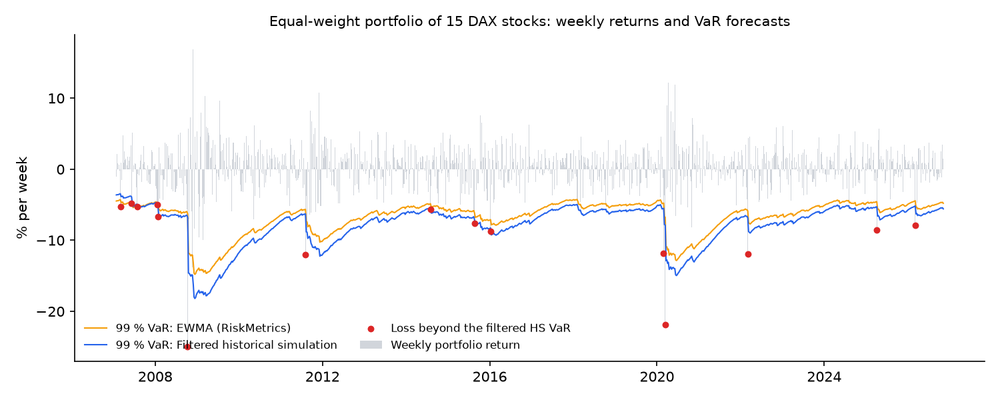
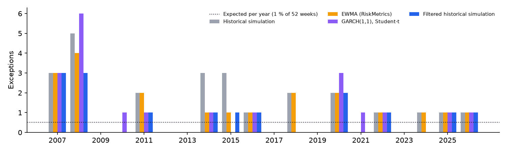

# DAX Risk Monitor


How much can a portfolio of German blue chips lose in a bad week, and which risk model would have told you in time? This project forecasts the weekly 99 % Value-at-Risk of a portfolio of 15 DAX stocks with four models. It backtests them over 20 years, including the 2008 crisis, the euro crisis, COVID and the 2022 energy shock, with the tests a bank regulator uses.

## Current risk

<!-- SNAPSHOT:START -->
*Week ending 2026-11-06. Updated automatically every week.*

| Next week's 99 % VaR | Loss on a EUR 1m portfolio |
|---|---:|
| Historical simulation | EUR 77,797 (7.8%) |
| EWMA (RiskMetrics) | EUR 47,538 (4.8%) |
| GARCH(1,1), Student-t | EUR 52,791 (5.3%) |
| Filtered historical simulation | EUR 55,359 (5.5%) |

| Stock | Sector | Volatility | Beta | Share of risk | Sharpe | Max drawdown |
|---|---|---:|---:|---:|---:|---:|
| Infineon | Semiconductors | 50% | 1.53 | 10.2% | 0.41 | -97% |
| Deutsche Bank | Banks | 32% | 1.45 | 9.7% | 0.18 | -92% |
| BMW | Autos | 30% | 1.45 | 9.7% | 0.35 | -61% |
| Siemens | Industrials | 26% | 1.40 | 9.3% | 0.45 | -63% |
| Bayer | Pharma | 46% | 1.38 | 9.2% | 0.34 | -82% |
| Mercedes-Benz | Autos | 25% | 1.34 | 8.9% | 0.32 | -76% |
| Adidas | Consumer | 32% | 1.32 | 8.8% | 0.42 | -68% |
| BASF | Chemicals | 24% | 1.11 | 7.4% | 0.37 | -58% |
| Allianz | Insurance | 19% | 0.85 | 5.7% | 0.49 | -73% |
| Henkel | Consumer | 23% | 0.72 | 4.8% | 0.41 | -54% |
| SAP | Software | 38% | 0.71 | 4.7% | 0.47 | -50% |
| Munich Re | Insurance | 19% | 0.59 | 3.9% | 0.59 | -44% |
| Deutsche Telekom | Telecom | 25% | 0.55 | 3.7% | 0.37 | -39% |
| RWE | Utilities | 27% | 0.31 | 2.1% | 0.28 | -84% |
| E.ON | Utilities | 23% | 0.29 | 2.0% | 0.27 | -75% |
<!-- SNAPSHOT:END -->

## Backtest: which model would have been right?

Every model forecasts next week's 99 % VaR using only the data available at the time. A loss larger than the forecast is an *exception*. A correct 99 % model should have about 1 exception per 100 weeks: 10.4 over the 1,041 weeks from January 2007 to November 2026.

| Model | Exceptions (expected 10.4) | Kupiec test | Basel green zone | Average VaR |
|---|---:|---|---:|---:|
| Historical simulation (last 2 years) | 25 | ❌ rejected (p < 0.001) | 45 % of the time | 7.3 % |
| EWMA / RiskMetrics (normal) | 20 | ❌ rejected (p = 0.008) | 79 % | 6.7 % |
| GARCH(1,1), Student-t | 20 | ❌ rejected (p = 0.008) | 70 % | 6.6 % |
| **Filtered historical simulation** | **15** | ✅ not rejected (p = 0.18) | **97 %** | 7.8 % |



**What the backtest shows:**
- **Every model underestimates risk to some degree.** Weekly stock returns have fatter tails than the models assume, and all four were caught out in 2007–08.
- **Historical simulation fails worst.** A two-year window forgets the last crisis: by 2014 its window held only calm weeks, and it was in the regulator's yellow zone more than half of the time.
- **The normal distribution is too thin.** EWMA reacts quickly to rising volatility but assumes normally distributed returns, so it still has twice the expected number of exceptions.
- **Filtered historical simulation passes.** It combines EWMA's fast reaction with the real, fat-tailed shape of past shocks. It is the only model consistent with 99 %, and it stays in the green zone 97 % of the time. The price: the highest average VaR, so a bank using it would hold the most capital.
- **Exceptions are about 1.5–1.7× beyond the VaR on average.** When VaR is exceeded, the loss is far larger than the forecast. That's why regulators moved from VaR to Expected Shortfall.



The fourth model was added after the first three failed the backtest. Its result therefore comes from the same 20 years it was chosen on, not from a separate test period.

## The portfolio

An equal-weight portfolio of 15 DAX companies with full history back to 2005, rebalanced weekly:
- **Tech and industrials:** SAP, Siemens, Infineon.
- **Financials:** Allianz, Munich Re, Deutsche Bank.
- **Autos and chemicals:** Mercedes-Benz, BMW, BASF.
- **Pharma and consumer:** Bayer, Adidas, Henkel.
- **Telecom and utilities:** Deutsche Telekom, RWE, E.ON.

| Since January 2005 | |
|---|---:|
| Return per year | 10.8 % |
| Volatility per year | 21.4 % |
| Sharpe ratio (vs ECB rate) | 0.52 |
| Maximum drawdown | −58 % (2007–09) |
| Worst week | −24.9 % (week to 10 October 2008) |

## Data

- **Prices:** [Alpha Vantage](https://www.alphavantage.co), weekly closes on XETRA, adjusted for dividends and splits, from January 2005. The free tier gives full weekly history (daily history is a paid feature) and 25 requests a day, so every response is cached.
- **Risk-free rate:** the ECB main refinancing rate from the [Deutsche Bundesbank statistics API](https://www.bundesbank.de/en/statistics/time-series-databases), used for the Sharpe ratios.
- **Checks:** every week where a stock moved more than 25 % was traced to a real event, such as October 2008, Infineon during the Qimonda crisis, the COVID crash, SAP's October 2020 profit warning, and Deutsche Bank when the war in Ukraine began. None came from a data error. Spin-offs like Daimler Truck are correctly adjusted.

## Methods

| Model | How it forecasts |
|---|---|
| Historical simulation | 1 % quantile of the last 104 weekly returns |
| EWMA (RiskMetrics) | Exponentially weighted volatility (λ = 0.97) × the normal 99 % quantile |
| GARCH(1,1), Student-t | Volatility clustering and fat tails; re-estimated every quarter on all data up to then |
| Filtered historical simulation | Today's EWMA volatility × the 1 % quantile of all past returns divided by their volatility at the time |

| Test | Question |
|---|---|
| Kupiec (proportion of failures) | Is the number of exceptions consistent with 99 %? |
| Christoffersen (independence) | Do exceptions come in clusters? |
| Basel traffic light | In every window of 250 weeks: green up to 4 exceptions, yellow 5–9, red 10 or more |

**Also reported:**
- each stock's share of portfolio risk (Euler allocation);
- beta against the portfolio, volatility, Sharpe ratio and maximum drawdown.

## Running it

```bash
python -m venv .venv
.venv\Scripts\activate             # source .venv/bin/activate on Mac/Linux
pip install -r requirements.txt
copy .env.example .env             # add a free Alpha Vantage key

python data.py                     # 15 requests; cached for a week
python report.py                   # backtest, charts, summary, README snapshot
pytest                             # 13 tests, no key needed
```

A [GitHub Actions workflow](.github/workflows/refresh.yml) runs every Saturday. It fetches the new week, re-runs the backtest and commits the updated snapshot. It needs the key as a repository secret named `ALPHAVANTAGE_API_KEY`.

## Project structure

```
data.py          Alpha Vantage prices (cached), Bundesbank ECB rate, returns, portfolio
risk.py          four VaR models, Kupiec, Christoffersen, traffic light, drawdown, risk contributions
report.py        backtest, charts, summary.json, README snapshot
tests/           no-look-ahead check for every model, statistical tests against known values
```

## Limitations

- **Survivorship bias.** The portfolio holds 15 companies that are still in the DAX today. Companies that fell out (Commerzbank for years, Wirecard, Lufthansa) are missing, so past returns look better than an investor would have experienced.
- **Weekly, not daily.** Banks report 1-day and 10-day VaR on daily data, which needs a paid data plan. Weekly data still covers every crisis since 2005.
- **No transaction costs or currency effects.** The portfolio is in euros and rebalanced for free.
